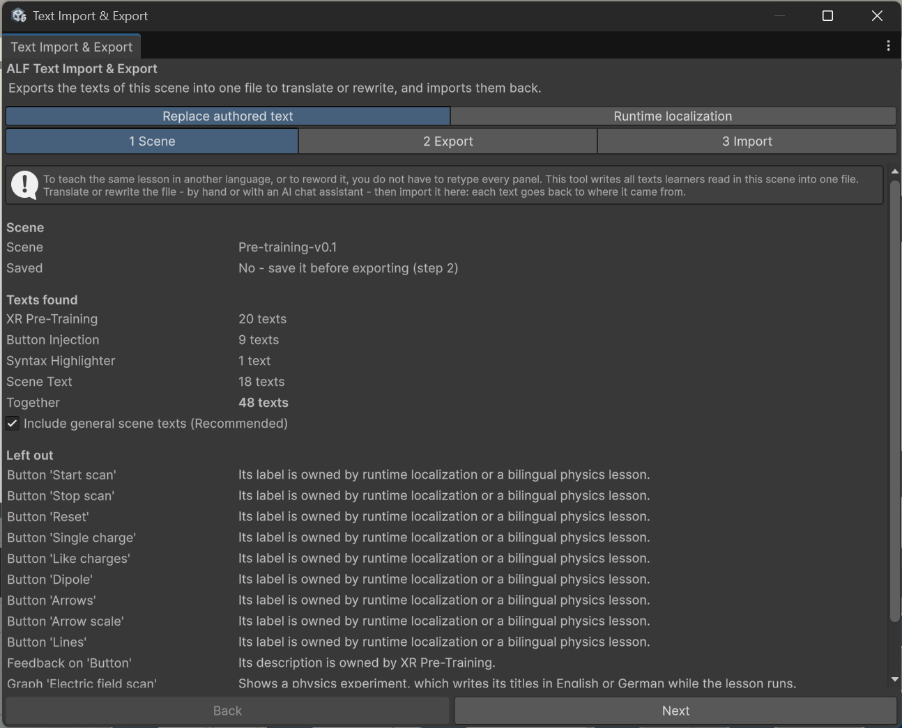

# Text Import & Export

**Menu:** ALF > Utils > Text Import & Export

Every text learners read in a lesson is spread over many tools: instruction panels, warm-up hints, infoboxes, button labels, graph titles. To offer the lesson in another language, or to reword it, you don't have to open each tool and retype every panel. This tool collects all texts of a scene in one place.

It has two ways of working, shown as two tabs at the top of the window:

| Tab | Use it when | What learners get |
|---|---|---|
| **Replace authored text** | You want the lesson in **one** other language, or reworded. You export the texts to a file, translate or edit it (by hand or with an AI chat assistant), and import it back. | The lesson in the new wording. One language at a time. |
| **Runtime localization** | Learners should **choose the language themselves** on the headset. | A language button in the scene. The lesson starts in the headset's language if a translation exists. |

## Quick start: translate a lesson

1. Open the lesson scene and save it.
2. Open **ALF > Utils > Text Import & Export**, tab **Replace authored text**.
3. In step **2 Export**, press **Export the texts** and save the file.
4. Translate the texts in the file, for example with an AI chat assistant. **Copy the instructions** gives you a ready-made prompt.
5. In step **3 Import**, press **Choose a file**, check the list, and press **Import … texts**.
6. Try the lesson, then save the scene.

## Quick start: let learners switch languages

1. Open the lesson scene and save it.
2. Open **ALF > Utils > Text Import & Export**, tab **Runtime localization**.
3. In **1 Enable**, press **Enable / update localization**.
4. In **2 Translate**, create a translation file, for example with **+ Quick Add German Translation**, and translate it.
5. In **3 Check & save**, check the files and save the scene.

## Guides

1. [Before you start](./how-to/before-you-start.md)
2. [Export the texts](./how-to/export-the-texts.md)
3. [Translate with an AI chat assistant](./how-to/translate-with-ai.md)
4. [Import the texts](./how-to/import-the-texts.md)
5. [Let learners switch languages](./how-to/switch-languages.md)
6. [Troubleshooting](./how-to/troubleshooting.md)
