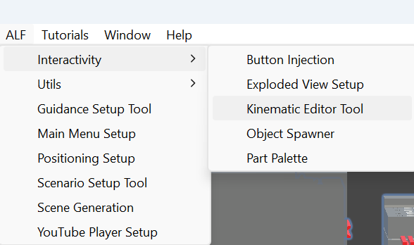

# Starting positions and axes

The Kinematic Editor Tool makes parts of a machine move: a slider that slides, a lever or door that swings, a wheel that spins. Each part moves smoothly between limits you set, and stops there by itself. Nothing else in the scene can push it, so it always moves exactly as set up.

New to Unity? The basic terms (Scene, Hierarchy, Play mode) are explained in [Before you start](../../../before-you-start.md).

## What you need

- **The machine in your scene**, for example placed with [Object Spawner](../../object-spawner/index.md).
- **Separate parts.** The part that moves must be its own object inside the machine. In the Hierarchy, click the arrow next to the machine to see its parts.

## Put the parts in their starting position first

All limits are measured **from where the part is when the scene starts**. Before you set up a movement, put the part in its starting position: the door closed, the slider at its end, the lever up.

## The window

In Unity's top menu, choose **ALF > Interactivity > Kinematic Editor Tool**. The window has four steps:

| Step | What you do there |
|---|---|
| **1 Object** | Drag the machine from the Hierarchy into **Drag object here ->**. |
| **2 Part** | Click the part that should move in the **Object hierarchy** list. **Target Object** shows your choice. |
| **3 Movement** | Add a movement to the part and set it up under **Customization settings**. |
| **4 Controls** | Optional: build a panel of buttons that moves every part. |

To set up several parts of one machine, go back to step **2 Part**, click the next part, and set it up in step **3 Movement**.

## Axes: X, Y and Z

Every object has three directions:

| Axis | Colour in the Scene view | Usually means |
|---|---|---|
| **X** | red | left and right |
| **Y** | green | up and down |
| **Z** | blue | forward and back |

You'll choose one of these for each moving part. They're measured along the axes of the part's **parent**, the object it sits inside in the Hierarchy, not the world's.

:::tip[Seeing the parent's axes]
Select the parent object and look at the coloured arrows in the Scene view. Make sure the toolbar is set to **Local** rather than **Global**, so the arrows follow the object's own rotation.
:::

## One movement per part

A part can have one movement: sliding **or** turning. To combine them, for example a part that slides and also turns, split it into two objects, one inside the other, and give each its own movement.

To change a part's movement, press **Remove Kinematic Movement Script** in step **3 Movement**, then add the other one.
