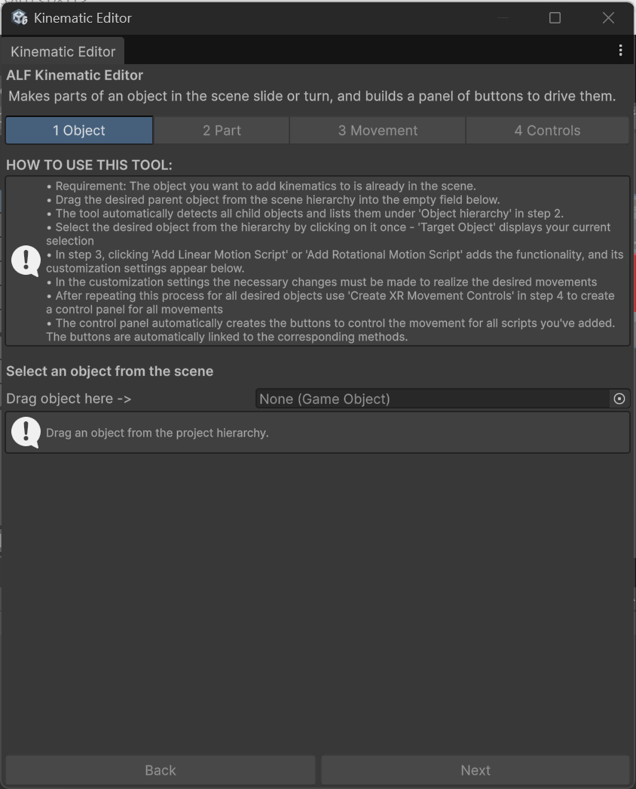
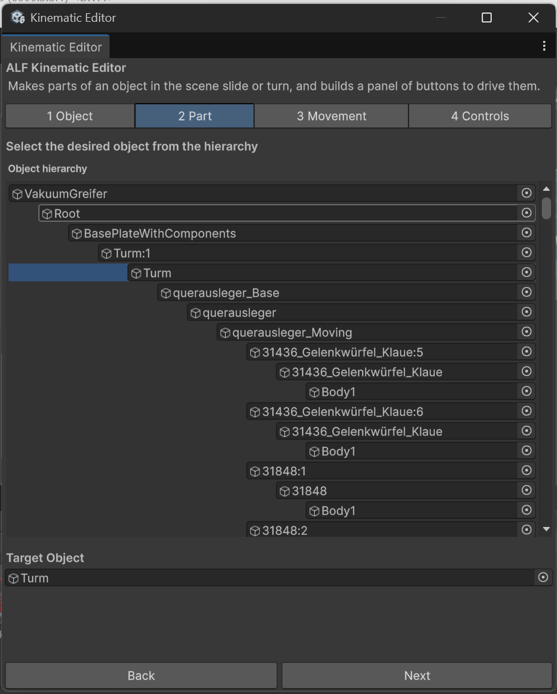
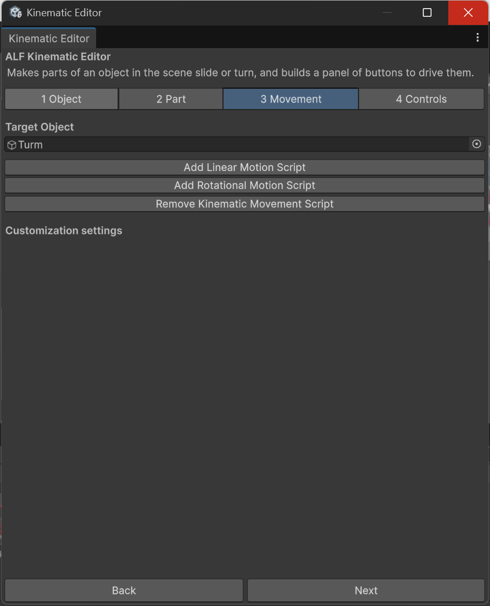
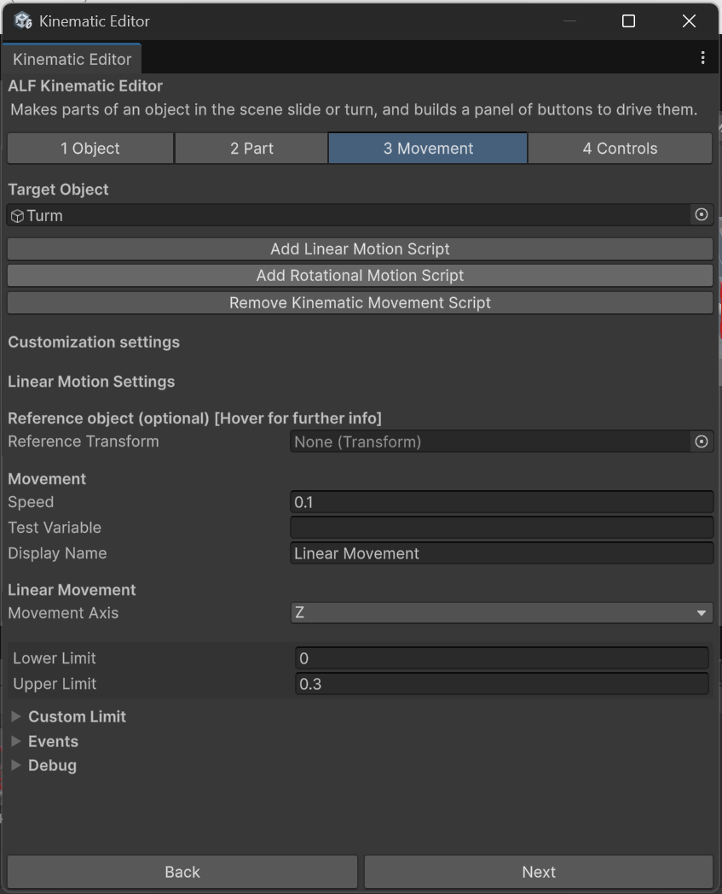

# Make a part slide

**Goal:** make a part move back and forth in a straight line, like a slider, drawer or piston.

## Steps

1. Put the part in its **starting position** in the scene.
2. Open **ALF > Interactivity > Kinematic Editor Tool**.

   

3. **1 Object:** drag the machine from the Hierarchy into **Drag object here ->**.

   

4. **2 Part:** click the part in the **Object hierarchy** list. Check that **Target Object** shows it.

   

5. **3 Movement:** press **Add Linear Motion Script**.

   

6. Under **Linear Motion Settings**, set:

   | Field | What to enter |
   |---|---|
   | **Movement Axis** | The direction to slide in: X, Y or Z of the part's parent. |
   | **Lower Limit** | How far it can move in the negative direction, in metres. Usually `0`, the start. |
   | **Upper Limit** | How far it can move in the positive direction, in metres. For example `0.3` for 30 cm. |
   | **Speed** | How fast it moves, in metres per second. For example `0.1`. |
   | **Display Name** | Optional: a name for this movement, shown on the control panel. |

   

7. Check the limits in the Scene view. With the part selected, you'll see:
   - a **green sphere** at the lower limit,
   - a **red sphere** at the upper limit,
   - a **yellow line** joining them.

   If the line points the wrong way, change the **Movement Axis**, or use a negative number, for example a lower limit of `-0.3` and an upper limit of `0`.
8. Add buttons so learners can move it. See [Add buttons that move the parts](./connect-to-a-button.md).
9. Save the scene with **Ctrl+S**.

## Result

When told to move in the **positive** direction, the part slides towards the red sphere and stops there. In the **negative** direction, it slides back towards the green sphere and stops.

## Good to know

- **Limits are measured from the starting position**, so `0` always means "where it starts".
- **If you enter the limits the wrong way round**, they're swapped automatically and a warning appears in the Console.
- **To stop partway**, see [Stop a part partway](./stop-partway.md).
