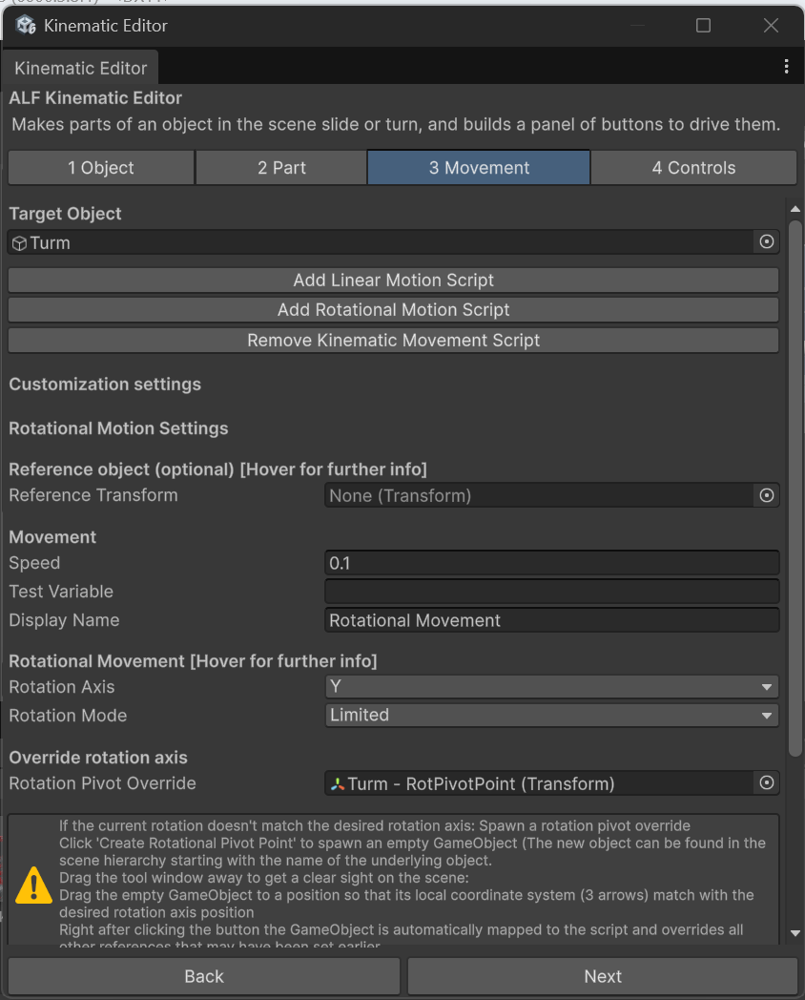

# Make a door or lever swing

**Goal:** make a part turn between two angles, like a door opening, a lever flipping or a flap lifting.

## Steps

1. Put the part in its **starting position**, for example the door closed.
2. Open **ALF > Interactivity > Kinematic Editor Tool**.
3. **1 Object:** drag the machine from the Hierarchy into **Drag object here ->**.
4. **2 Part:** click the part in the **Object hierarchy** list.
5. **3 Movement:** press **Add Rotational Motion Script**.
6. Under **Rotational Motion Settings**, set:

   | Field | What to enter |
   |---|---|
   | **Rotation Mode** | **Limited** |
   | **Rotation Axis** | The axis to turn around: X, Y or Z. A door usually turns around **Y**, the up axis. |
   | **Lower Limit** | Smallest angle, in degrees. Usually `0`, the start. |
   | **Upper Limit** | Largest angle, in degrees. For example `90` for a door opening a quarter turn. |
   | **Speed** | How fast it turns, in degrees per second. For example `45`. |

   

7. Check where it turns around. With the part selected, a **cyan line and sphere** in the Scene view mark the axis.
   - **If they're on the hinge**, you're done.
   - **If they're in the middle of the part**, it will spin in place instead of swinging. See [Turn a part around a hinge](./turn-around-a-hinge.md).
8. Add buttons so learners can move it. See [Add buttons that move the parts](./connect-to-a-button.md).
9. Save the scene with **Ctrl+S**.

## Result

In the **positive** direction, the part turns to the upper limit and stops. In the **negative** direction, it turns back to the lower limit and stops.

## Good to know

- **Turning the wrong way?** Use negative limits instead, for example lower `-90` and upper `0`.
- **To stop partway**, for example a valve half open, see [Stop a part partway](./stop-partway.md).
