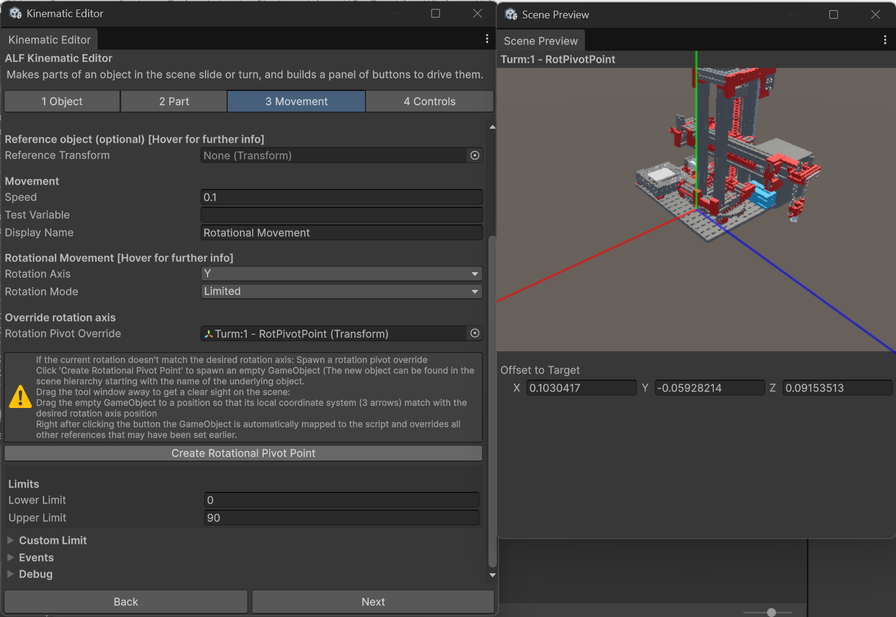

# Turn a part around a hinge

**Goal:** make a part swing around the right point, such as a door around its hinge, when it would otherwise spin around its own centre.

## Why this happens

Every object turns around its own **pivot point**. In models from CAD programs, that point is often somewhere unhelpful: in the middle of the part, at a corner, or even outside it. A door turning around its middle looks like a revolving door, not a real one.

You don't need to change the model. The tool adds a marker on the real hinge, and the part turns around that instead.

## Steps

1. Set up the part as in [Make a door or lever swing](./make-a-part-swing.md), up to step 6.
2. Under **Rotational Motion Settings**, press **Create Rotational Pivot Point**.
3. The tool creates a marker called `<part> - RotPivotPoint` and opens a small window to place it. You'll also find the marker in the Hierarchy under that name.

   

4. Move the tool window aside so you can see the scene.
5. Move and turn the marker so that it sits exactly on the hinge, with one of its arrows pointing along the hinge line.
   For a normal door: on the hinge edge, with its green **Y** arrow pointing straight up.
6. Set **Rotation Axis** to the marker's arrow that runs along the hinge, for example **Y**.
7. Check the Scene view: the **cyan line and sphere** should now sit on the hinge.
8. Save the scene with **Ctrl+S**.

## Result

The part swings around the hinge. The marker is connected to the part's **Rotation Pivot Override** field automatically. Nothing in the model's Hierarchy changes.

## Good to know

- **The rotation axis is now the marker's.** Turning the marker turns the hinge line.
- **The button only works once per part.** If the part already has a marker, nothing happens. To start over, delete the marker in the Hierarchy and press the button again.
- **Wheels work the same way.** Put the marker at the wheel's centre, with an arrow along its axle.
