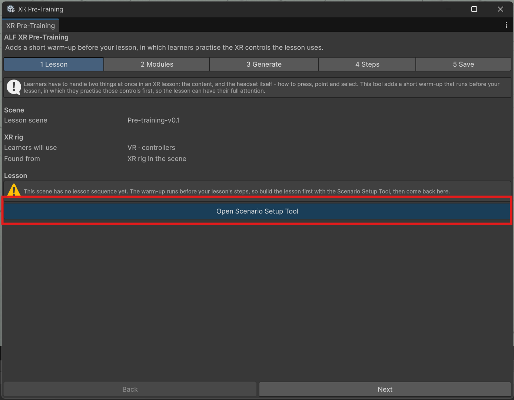
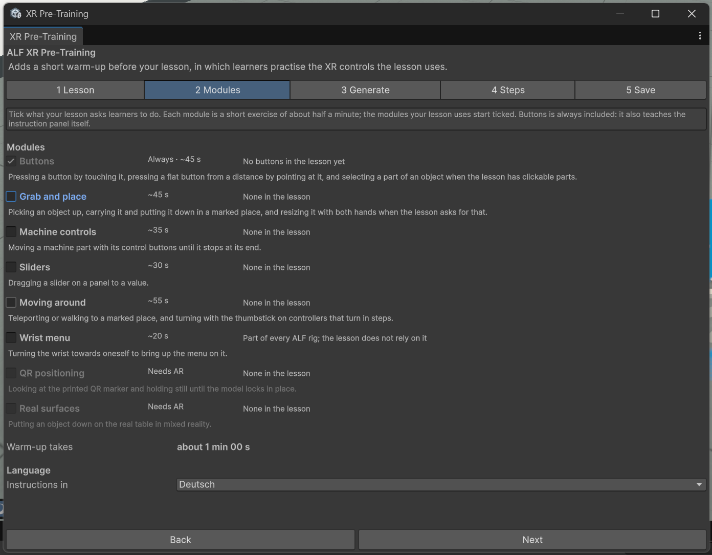

# Add a warm-up to a lesson

**Goal:** put a short practice session in front of your lesson.

## Steps

1. Open the lesson scene, then **ALF > XR Pre-Training**.
2. In step **1 Lesson**, check:
   - **Lesson scene**: the scene you want.
   - **Learners will use**: the player setup, for example VR with controllers. **Found from** says where the tool read it.
   - **Lesson steps**: how many steps your lesson has.

   If there's no lesson yet, press **Open Scenario Setup Tool** and build it first.

   

3. In step **2 Modules**, look at the list of exercises:
   - Exercises your lesson uses are **already ticked**. Each row says what it practises, what the tool found in your lesson, and about how long it takes.
   - **Buttons** is always included.
   - Greyed-out exercises don't fit the player setup. The reason is shown next to them.
   - **Warm-up takes** shows the total length. Keep it under five minutes: untick exercises your learners already know.

   

4. Under **Language**, choose **Deutsch** or **English** for the instructions.
5. In step **3 Generate**, set **Hint after (seconds)**: how long a learner can be stuck before they get extra help. Anything from 5 to 120 seconds; 15 by default.
6. Read **What this adds**. It lists what will be created and confirms that your lesson isn't changed.
7. Press **Add the warm-up**.
8. Optional: in step **4 Steps**, change the wording, the hints or where the panel stands. See [Edit the practice steps](./edit-the-steps.md).
9. In step **5 Save**, check for overlap warnings. If practice objects overlap your lesson's content, see [Move the station](./change-or-remove.md#move-the-station).
10. Press **Save the scene**.

## Result

The scene has a practice station where the learner starts, and a warm-up that runs before the lesson. When learners finish it, the station disappears and your lesson starts at its first step.

The warm-up doesn't show up in [Scenario Setup](../../scenario-setup/index.md): there you only see and edit your lesson. The practice steps are listed and edited here, in step 4.

Try it in Play mode or on the headset. See [What learners experience](./what-learners-experience.md).

## Good to know

- **Undo works.** Adding, regenerating, saving step changes and removing are each one step with **Ctrl+Z**.
- **The tool remembers your choice.** Reopening it shows the exercises, the language and the hint delay you chose.
- **Practice buttons can be adjusted** in [Button Injection](../../button-injection/index.md), and the practice cube in the [Object Spawner](../../object-spawner/index.md), like any other.
- **Translating the warm-up:** its texts and hints are included in [Text Import & Export](../../text-import-export/index.md).
