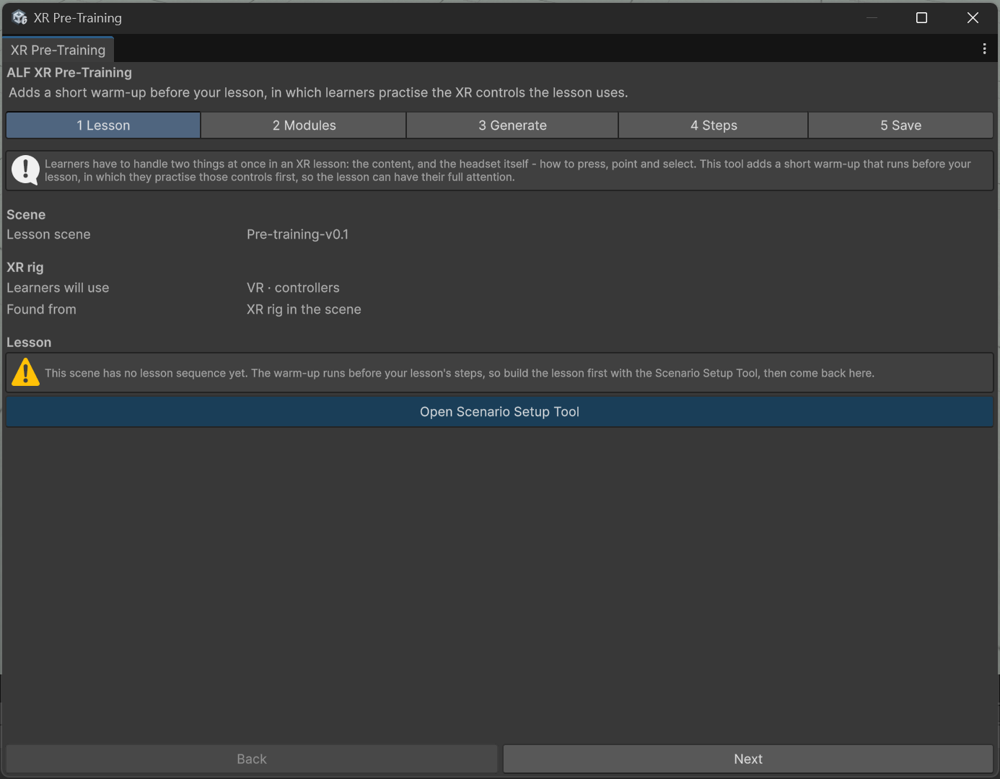

# How XR Pre-Training works

In XR, learners have to deal with two new things at once: the lesson content and the controls themselves. A short warm-up takes the second one off their plate. Each exercise practises **one skill**, takes about **30 to 60 seconds**, and gives immediate feedback.

New to Unity? The basic terms (Scene, Hierarchy, Play mode) are explained in [Before you start](../../../before-you-start.md).

## What you need

A **finished lesson**: a scene with a player setup from [Scene Generation](../../scene-generation/index.md) and lesson steps from [Scenario Setup](../../scenario-setup/index.md). The tool reads the lesson to decide which exercises are useful, so add the warm-up last, or regenerate it when the lesson changes.

## How the tool decides

The tool looks at two things:

- **What your lesson uses**, for example buttons, objects to pick up, moving machine parts, sliders or places to walk to. Exercises for those are ticked automatically.
- **The player setup** in the scene: VR or AR, hands or controllers, whether the player can teleport. The instructions are worded for it, for example "pinch" for hands or "trigger" for controllers. Exercises that don't fit the setup are greyed out, with the reason.

## What it adds

- A **practice station**: the practice objects, an instruction panel and a feedback label, placed where the learner starts.
- A **warm-up sequence** of its own: a welcome, one or two steps per exercise, and a closing step. It runs before your lesson.

Your lesson isn't touched. Its steps stay as they are, with the same numbers, and the warm-up's steps don't appear in Scenario Setup.

## The window

| Step | What you do there |
|---|---|
| **1 Lesson** | Check the scene, the player setup and the lesson the tool found. |
| **2 Modules** | Choose the exercises and the language. |
| **3 Generate** | Set the hint delay, then add or regenerate the warm-up. |
| **4 Steps** | Change the text, look, hint and panel position of each practice step. |
| **5 Save** | Move the station, save the scene, or remove the warm-up. |

:::caution[Not while the scene is playing]
The tool doesn't work in Play mode. Stop Play mode first.
:::
