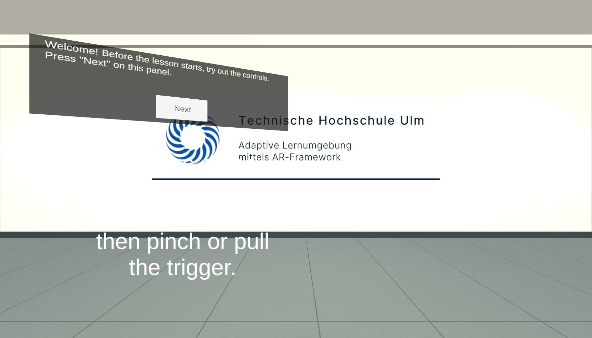

# What learners experience

## The order

1. A **welcome** step explains the warm-up. Learners press **Next** on the panel.
2. The **exercises** follow, one skill per step. Only the objects for the current exercise are visible, the rest are hidden. Nothing from your lesson is visible yet.
3. A **closing** step says the warm-up is done. It has two buttons:
   - **Restart** runs the whole warm-up again, for learners who want more practice.
   - **End** removes the practice station and starts your lesson.
4. Your **lesson** begins at its first step.

The instruction panel stands to the left of the practice objects. A short feedback line appears below it.

## Feedback

- **When they get it right**, the practice object briefly turns green and the feedback line shows "✓ Well done!". The next step starts by itself.
- **When they're stuck** for longer than the hint delay (15 seconds by default), the feedback line shows the step's hint, for example where the button is and how to press it, and the object pulses amber.

## Good to know

- **Next doesn't skip an exercise.** On steps that check what the learner does, Next does nothing until the task is done. The instruction and the hint say what to do.
- **There's no way back into the warm-up** once learners press **End**. To practise again, they press **Restart** on the closing step instead, or restart the app.
- **The canvas buttons are labelled "Next", "End" and "Restart"** in both languages, so the German instructions use those words too.
