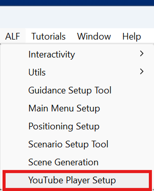
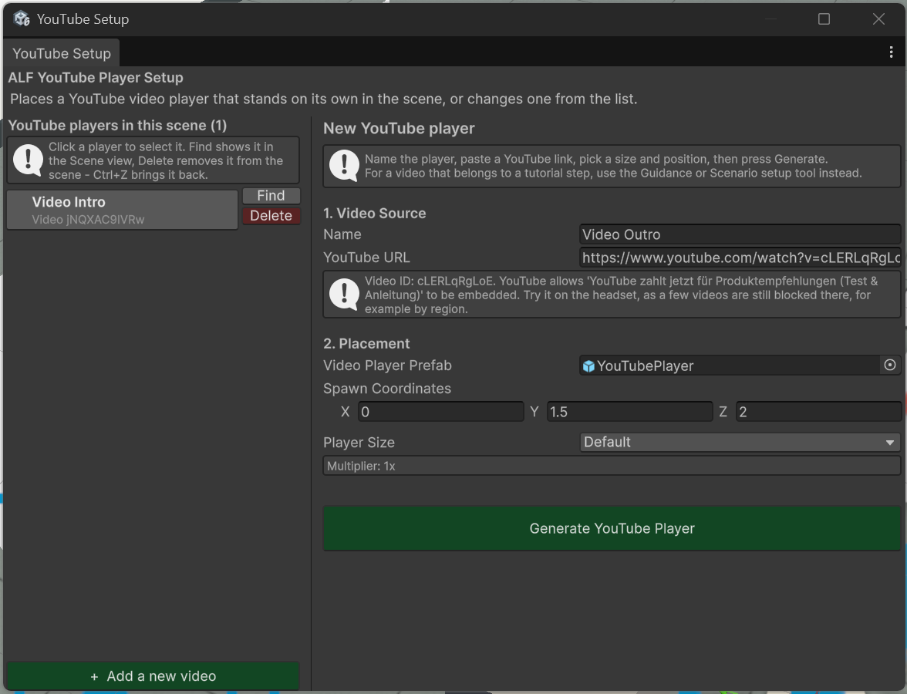

# Add a video screen

**Goal:** place a screen in the room that plays a YouTube video.

New to Unity? The basic terms (Scene, Hierarchy, Play mode) are explained in [Before you start](../../../before-you-start.md).

## Steps

1. Open **ALF > Content Creation > YouTube Player Setup**.

   

2. Under **1. Video Source**, paste the video's link into **YouTube URL**. Normal, share, embed, shorts and live links all work.
3. Check the box below the link:
   - **Video ID detected:** followed by a code means the link works.
   - **No video ID could be read from this URL** means it doesn't. Copy the link again from YouTube.
4. Under **2. Placement**:

   | Field | What to do |
   |---|---|
   | **Video Player Prefab** | Leave as it is. It's filled in for you. |
   | **Spawn Coordinates** | Where the screen appears, in metres from the centre of the world. |
   | **Player Size** | **Small**, **Default**, **Big** or **Large**, or **Custom** with your own **Custom Multiplier**. |

   

5. Press **Generate YouTube Player**.
6. The screen appears in the scene and is selected. Move it into its final place in the Scene view if needed.
7. Save the scene with **Ctrl+S**.

## Result

The screen stands in the room. Learners use its play controls by pointing at them with the controller ray.

## Good to know

- **Choosing a size changes the height.** Bigger screens grow downwards, so the tool lifts them to keep the controls above the floor. Set **Spawn Coordinates** after choosing the size if you want a different height.
- **The headset needs internet access** to play the video.
- **You can add several screens.** Run the tool again for each one.
