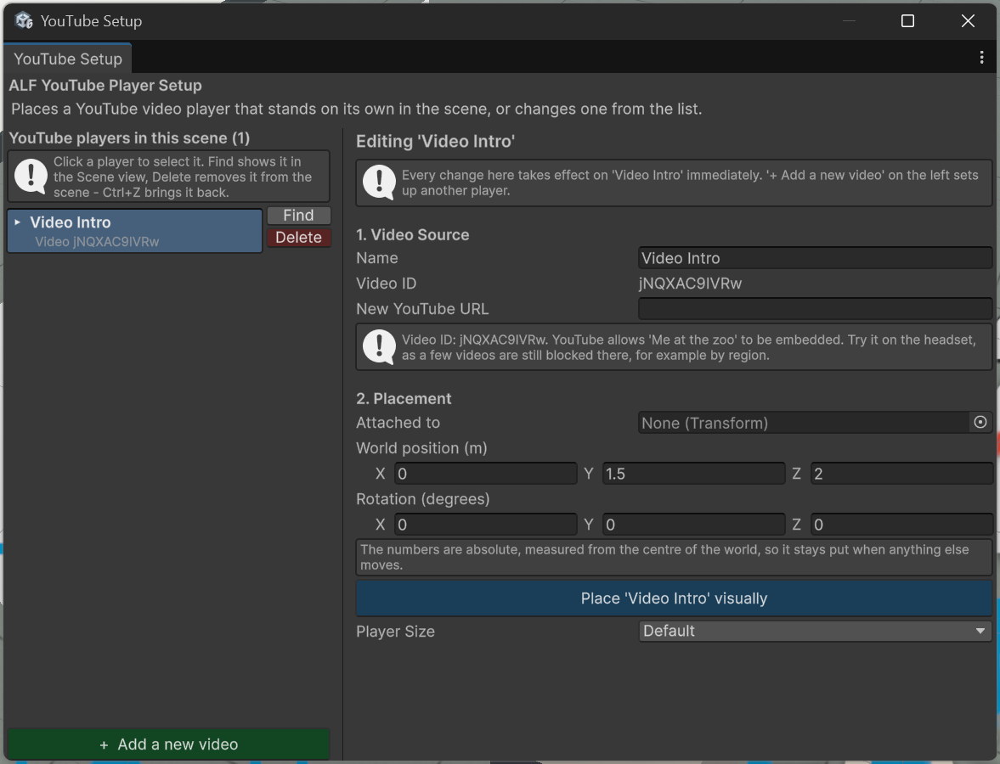

# Add a video screen

**Goal:** place a screen in the room that plays a YouTube video.

New to Unity? The basic terms (Scene, Hierarchy, Play mode) are explained in [Before you start](../../../before-you-start.md).

## Before you start: check the video in YouTube

The screen can only play videos that YouTube allows in other apps:

- **Public** and **unlisted** videos work. Unlisted is a good choice for your own lesson videos: they play in the lesson but don't show up in YouTube searches.
- **Private** videos don't work.
- Videos whose owner has switched off **Allow embedding** don't work. For your own videos, you find this setting in **YouTube Studio** under the video's details.

The tool checks this for you when you paste the link (step 4 below).

## Steps

1. Open **ALF > Content Creation > YouTube Player Setup**.

   

2. The window has two halves. On the left, **YouTube players in this scene** lists the screens already there. On the right is the form for a new one. If a screen is selected, press **+ Add a new video** on the left to get an empty form.
3. Under **1. Video Source**:
   - **Name:** what the screen is called in the Hierarchy and in the list, for example *Intro video*. Left empty, it's called *YouTube Player*.
   - **YouTube URL:** paste the video's link. Normal, share, embed, shorts and live links all work.
4. Check the boxes below the link:
   - The **video ID** appears: the link works. If you see **No video ID could be read from this URL**, copy the link again from YouTube.
   - The **video check** shows the video's title and whether it can be embedded. If it says the video is private or embedding is switched off, change that in YouTube Studio, or choose another video.

   

5. Under **2. Placement**:

   | Field | What to do |
   |---|---|
   | **Video Player Prefab** | Leave as it is. It's filled in for you. |
   | **Player Size** | **Small**, **Default**, **Big** or **Large**, or **Custom** with your own **Custom Multiplier**. |
   | **Spawn Coordinates** | Where the screen appears, in metres from the centre of the world. |

   

6. Press **Generate YouTube Player**.
7. The screen appears in the scene and in the list on the left. Move it into its final place in the Scene view if needed.
8. Save the scene with **Ctrl+S**.

## Result

The screen stands in the room. In the headset, learners first see the video's preview picture with a large **Play video** button. They press it, or **Play** below the picture, to start the video. See [What learners see](./what-learners-see.md).

## Good to know

- **The video plays only on the headset.** In the Unity Editor, and over Quest Link, the screen stays empty and says so. Test videos in the app on the headset.
- **The headset needs internet access** to play the video.
- **Choosing a size changes the height.** Bigger screens grow downwards, so the tool lifts them to keep the controls above the floor. Set **Spawn Coordinates** after choosing the size if you want a different height.
- **You can add several screens.** Press **+ Add a new video** for each one. Two screens with the same name get a number added, for example *Intro video (1)*.
