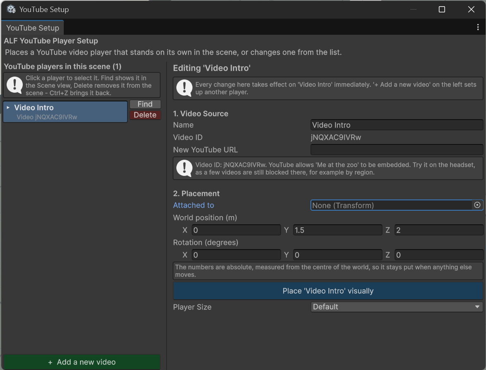

# Change or remove a video screen

All screens in the scene are listed on the left of **ALF > Content Creation > YouTube Player Setup**, under **YouTube players in this scene**. Each row shows the screen's name and its video.

## Change a screen

1. Open **ALF > Content Creation > YouTube Player Setup**.
2. Click the screen in the list. The right half now says **Editing '…'**. Every change you make there applies to that screen straight away.
3. Change what you need:

   | To change… | Do this |
   |---|---|
   | The name | Type a new **Name**. |
   | The video | Paste a link into **New YouTube URL**. The **Video ID** changes, and the video check below shows whether the new video can be embedded. |
   | Where it stands | Change the position and rotation under **2. Placement**, or move the screen in the Scene view. |
   | Its size | Choose another **Player Size**. |

4. Save the scene with **Ctrl+S**.

Each change can be undone with **Ctrl+Z**.

## Find a screen in the scene

Click **Find** in the screen's row. Unity shows it in the Scene view.

## Remove a screen

1. Click **Delete** in the screen's row.
2. Save the scene with **Ctrl+S**.

**Ctrl+Z** brings the screen back.

## Add another screen

Press **+ Add a new video** below the list. The form on the right empties for a new screen; the size and position you used last are kept. Then follow [Add a video screen](./add-a-video-screen.md) from step 3.
